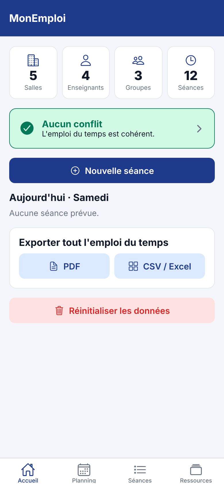
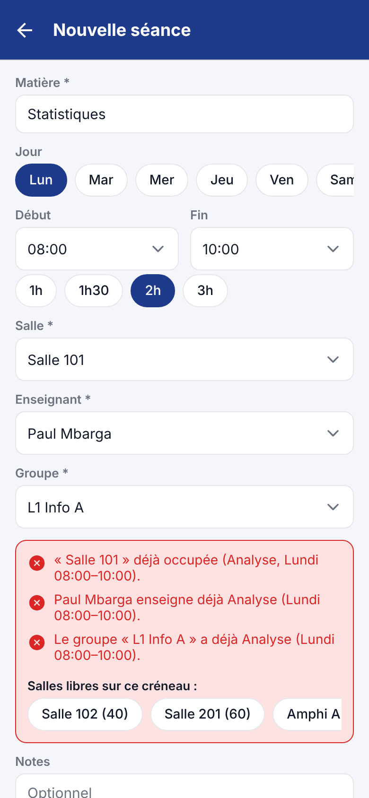

**Dépôt GitHub public :** <https://github.com/yvantchemi/MonEmploi>

# 1. Présentation du projet

## 1.1 Contexte et problème

Dans l'établissement, la planification des salles et des enseignants se fait sur
fichier (Excel, papier). Les **conflits d'horaire** (deux cours dans la même salle,
un enseignant attendu à deux endroits à la fois, un groupe qui a deux cours en
même temps) ne sont découverts que **tardivement**, souvent le jour même.

## 1.2 Objectif

Construire une **application mobile** permettant de bâtir un emploi du temps en
**détectant les conflits au moment de la saisie**, et non après coup.

## 1.3 Périmètre fonctionnel demandé et réponse apportée

| Exigence du sujet | Réalisation dans l'application |
|---|---|
| Salles, enseignants et groupes | Onglet **Ressources** : création, modification, suppression (CRUD) des trois entités |
| Création de séance | Écran **Nouvelle séance** : matière, jour, début, fin (raccourcis 1h / 1h30 / 2h / 3h), salle, enseignant, groupe, notes |
| Détection de conflit | Moteur de détection exécuté **à chaque modification du formulaire** ; écran **Conflits** global ; badge rouge sur l'onglet Accueil |
| Vue par enseignant et par groupe | Onglet **Planning** : vue par enseignant, par groupe (et en bonus par salle), en semaine ou par jour, avec volume horaire hebdomadaire |
| Modification | Toute séance ou ressource se modifie en la touchant ; la détection s'applique aussi aux modifications |
| Export | **PDF** (grille hebdomadaire A4 paysage) et **CSV** (Excel), du planning complet ou d'un enseignant / groupe / salle, partagés via la feuille de partage du téléphone |

Fonctions supplémentaires : suggestion de salles libres, avertissement de
capacité (effectif du groupe > places de la salle), recherche et filtres sur
les séances, jeu de données d'exemple, réinitialisation.

# 2. Choix technologiques

## 2.1 Vue d'ensemble

| Technologie | Version | Rôle | Pourquoi ce choix |
|---|---|---|---|
| **React Native** | 0.88 | Framework d'interface mobile | Une seule base de code pour Android **et** iOS, composants natifs (pas une page web) |
| **Expo** (SDK) | 58 | Outillage autour de React Native | Pas besoin d'Android Studio pour développer : test immédiat sur téléphone avec *Expo Go*, compilation APK dans le cloud avec *EAS Build* |
| **TypeScript** | 6.0 | Langage | JavaScript typé : les erreurs (champ manquant, mauvais type) sont détectées avant l'exécution |
| **Expo Router** | 58 | Navigation | Navigation basée sur les fichiers : chaque fichier de `src/app/` est un écran ; gère onglets, piles et modales |
| **expo-sqlite** | 58 | Base de données locale | SQLite embarqué dans le téléphone : données persistantes, requêtes SQL, contraintes d'intégrité, fonctionne hors ligne |
| **expo-print** | 58 | Génération PDF | Transforme un document HTML en fichier PDF sur le téléphone |
| **expo-file-system** | 58 | Fichiers | Écriture du fichier CSV dans le cache de l'application |
| **expo-sharing** | 58 | Partage | Ouvre la feuille de partage native (WhatsApp, Gmail, Drive, Bluetooth…) |
| **@expo/vector-icons** (Ionicons) | 15 | Icônes | Jeu d'icônes inclus, aucune image à télécharger |
| **react-native-safe-area-context**, **react-native-screens** | — | Support de la navigation | Respect des encoches et écrans natifs performants |
| **Node test runner + tsx** | Node 22 | Tests unitaires | Tests du moteur de conflits sans dépendance lourde |
| **ESLint** (eslint-config-expo) | 9 | Qualité du code | Règles React / React Hooks |

## 2.2 Alternatives écartées

- **Flutter (Dart)** : équivalent techniquement, mais React Native + TypeScript
  permet de réutiliser les connaissances web (JavaScript) et l'écosystème Expo
  simplifie énormément le test et la compilation.
- **Firebase / API distante** : inutile ici. Le sujet ne demande pas de
  synchronisation multi-utilisateurs ; une base distante ajouterait des requêtes
  réseau, une dépendance à Internet et des coûts. Tout reste **local**.
- **AsyncStorage (clé/valeur)** : pas de requêtes, pas de clés étrangères, pas
  d'index. SQLite est plus adapté à des données relationnelles.

# 3. Architecture

## 3.1 Architecture en couches

```
┌──────────────────────────────────────────────────────────────┐
│  ÉCRANS (src/app)          Accueil · Planning · Séances ·    │
│  Expo Router               Ressources · Formulaires · Conflits│
├──────────────────────────────────────────────────────────────┤
│  COMPOSANTS (src/components)  Carte de séance, sélecteurs,   │
│                               boutons, pastilles, export     │
├──────────────────────────────────────────────────────────────┤
│  ÉTAT GLOBAL (src/state/DataContext.tsx)                      │
│  Données en mémoire + index + liste des conflits (mémoïsés)  │
├───────────────────────────┬──────────────────────────────────┤
│  DOMAINE (src/domain)     │  EXPORT (src/export)             │
│  Types, gestion du temps, │  HTML/CSV (pur) + PDF/partage    │
│  MOTEUR DE CONFLITS (pur) │                                  │
├───────────────────────────┴──────────────────────────────────┤
│  ACCÈS AUX DONNÉES (src/db)  schema.ts · repository.ts        │
├──────────────────────────────────────────────────────────────┤
│  SQLite (fichier monemploi.db sur le téléphone)               │
└──────────────────────────────────────────────────────────────┘
```

Principe clé : le **domaine** (règles métier, détection des conflits) est écrit
en **fonctions pures**, sans dépendance à React ni à la base de données. Il est
donc testable sur un ordinateur, et réutilisable.

## 3.2 Arborescence du code

```
MonEmploi/
├── app.json              Configuration Expo (nom, icône, identifiant Android…)
├── eas.json              Profils de compilation (APK de test, AAB Play Store)
├── package.json          Dépendances et scripts (start, test, typecheck)
├── src/
│   ├── app/                         ← ÉCRANS (un fichier = un écran)
│   │   ├── _layout.tsx              Racine : base SQLite + état global + pile
│   │   ├── (tabs)/_layout.tsx       Barre d'onglets
│   │   ├── (tabs)/index.tsx         Accueil (tableau de bord)
│   │   ├── (tabs)/planning.tsx      Vue par enseignant / groupe / salle
│   │   ├── (tabs)/seances.tsx       Liste, recherche, filtres
│   │   ├── (tabs)/ressources.tsx    Salles, enseignants, groupes
│   │   ├── seance/[id].tsx          Formulaire séance + conflits en direct
│   │   ├── ressource/[type]/[id].tsx Formulaire salle/enseignant/groupe
│   │   └── conflits.tsx             Liste globale des conflits
│   ├── components/      Composants d'interface réutilisables
│   ├── db/              schema.ts (tables, migrations) · repository.ts (SQL)
│   ├── domain/          types.ts · temps.ts · conflits.ts (moteur)
│   ├── export/          formats.ts (HTML, CSV) · export.ts (PDF, partage)
│   ├── state/           DataContext.tsx (état global)
│   └── theme/           Couleurs, espacements
├── tests/conflits.test.ts   Tests unitaires
└── docs/                Ce manuel + captures d'écran
```

## 3.3 Navigation

```
Pile racine (Stack)
├── Onglets (Tabs)
│   ├── Accueil ─────────────┐
│   ├── Planning             │  touche une séance  ──►  seance/[id]   (modale)
│   ├── Séances  ── (+) ─────┼──────────────────────►  seance/nouvelle
│   └── Ressources ── (+) ───┴──────────────────────►  ressource/[type]/[id]
└── conflits  (depuis la carte « N conflits » de l'accueil)
```

Les identifiants passent par l'URL de l'écran (`/seance/12`,
`/ressource/salle/nouvelle`), comme sur un site web.

# 4. Modèle de données

## 4.1 Modèle conceptuel (MCD)

```
  SALLE (1) ────────< (0..n) SEANCE (0..n) >──────── (1) ENSEIGNANT
                                │
                                │ (0..n)
                                ▼
                              (1) GROUPE
```

Une **séance** associe exactement **une salle**, **un enseignant** et **un
groupe** à un **créneau** (jour + heure de début + heure de fin). Une ressource
peut participer à plusieurs séances.

## 4.2 Modèle physique (tables SQLite)

**salle**

| Colonne | Type | Contraintes |
|---|---|---|
| id | INTEGER | Clé primaire, auto-incrément |
| nom | TEXT | Obligatoire, **unique** (insensible à la casse) |
| capacite | INTEGER | ≥ 0 |
| type | TEXT | Cours, TP, Amphi… |

**enseignant** : `id`, `nom` (obligatoire), `prenom`, `email`, `specialite` —
couple (nom, prénom) unique.

**groupe** : `id`, `nom` (unique), `effectif` (≥ 0), `niveau`.

**seance**

| Colonne | Type | Contraintes |
|---|---|---|
| id | INTEGER | Clé primaire |
| matiere | TEXT | Obligatoire |
| jour | INTEGER | 1 (lundi) à 6 (samedi) — `CHECK` |
| debut, fin | INTEGER | Minutes depuis minuit (08:30 → 510) ; `CHECK (fin > debut)` |
| salle_id | INTEGER | Clé étrangère → salle, `ON DELETE CASCADE` |
| enseignant_id | INTEGER | Clé étrangère → enseignant, `ON DELETE CASCADE` |
| groupe_id | INTEGER | Clé étrangère → groupe, `ON DELETE CASCADE` |
| notes | TEXT | Facultatif |

**Index** : `(salle_id, jour, debut)`, `(enseignant_id, jour, debut)`,
`(groupe_id, jour, debut)` — ils accélèrent les recherches par ressource et par
jour.

Choix importants :

- **Heures stockées en minutes** (entiers) : les comparaisons de chevauchement
  sont de simples comparaisons de nombres, sans conversion de texte.
- **Suppression en cascade** : supprimer une salle supprime ses séances.
  L'application **prévient** l'utilisateur avec le nombre de séances concernées
  avant de confirmer.
- **Migrations versionnées** avec `PRAGMA user_version` : le schéma peut
  évoluer dans une future version sans perdre les données.
- `PRAGMA foreign_keys = ON` et `journal_mode = WAL` (écritures plus rapides
  et plus sûres).

# 5. Détection des conflits (cœur du projet)

## 5.1 Règle de chevauchement

Deux créneaux `[débutA, finA[` et `[débutB, finB[` du **même jour** se
chevauchent si et seulement si :

```
débutA < finB   ET   débutB < finA
```

Les intervalles sont **semi-ouverts** : un cours 08:00–10:00 et un cours
10:00–12:00 dans la même salle **ne sont pas** en conflit (ils se suivent).

## 5.2 Types de conflits

| Type | Condition (même jour + chevauchement) | Gravité |
|---|---|---|
| **Salle** | même `salle_id` | Bloquant |
| **Enseignant** | même `enseignant_id` | Bloquant |
| **Groupe** | même `groupe_id` | Bloquant |
| **Capacité** | effectif du groupe > capacité de la salle | Avertissement |

Une séance en cours de **modification** ne se compare jamais à elle-même
(comparaison des identifiants).

## 5.3 Trois algorithmes (fichier `src/domain/conflits.ts`)

1. **`detecterConflits(séance, séances, index)`** — utilisé dans le
   formulaire. Parcourt les séances du même jour : coût **O(n)**, instantané
   même avec des milliers de séances. Renvoie des messages lisibles :
   « Paul Mbarga enseigne déjà Analyse (Lundi 08:00–10:00) ».
2. **`tousLesConflits(séances)`** — liste globale (écran Conflits, badge,
   surlignage rouge). Algorithme par **balayage** : les séances sont triées par
   (jour, début) ; on garde la liste des séances « encore ouvertes » et on ne
   compare une séance qu'à celles-ci. Coût **O(n log n + k)** au lieu de
   **O(n²)** pour une comparaison naïve de toutes les paires.
3. **`sallesLibres(séance, séances, salles, effectif)`** — propose les salles
   non occupées sur le créneau et assez grandes pour le groupe, de la plus petite
   à la plus grande (pour ne pas gaspiller un amphithéâtre).

## 5.4 Comportement dans l'interface

- Le panneau de résultat passe au **vert** (« Créneau libre ») ou au **rouge**
  avec la liste des conflits, à chaque changement de jour, d'heure ou de
  ressource.
- Dans les listes de choix, les ressources déjà prises sur le créneau sont
  marquées **« Occupée »**.
- À l'enregistrement d'une séance en conflit, une boîte de dialogue propose
  **« Corriger »** ou **« Enregistrer quand même »** (utile pour un brouillon).
  Dans ce cas la séance est affichée en rouge partout et apparaît dans l'écran
  Conflits jusqu'à sa correction.

# 6. Performance : « zéro requête superflue »

Le sujet demande une application sans requêtes superflues. Stratégie retenue :

1. **Aucune requête réseau** : pas de serveur, pas d'API, pas de
   téléchargement. Les icônes et polices sont incluses dans l'application.
2. **Une seule lecture complète** de la base, au démarrage
   (`chargerTout` : 4 `SELECT` exécutés en parallèle).
3. Ensuite, **chaque action = une seule requête d'écriture** (`INSERT`,
   `UPDATE` ou `DELETE` paramétrée). L'état en mémoire est mis à jour
   directement avec le résultat (l'`id` renvoyé par `INSERT` via
   `lastInsertRowId`) : **pas de rechargement** de la base après chaque
   modification.
4. **Détection des conflits en mémoire** : pendant la saisie, aucune requête
   n'est envoyée ; les calculs se font sur les données déjà chargées.
5. **Mémoïsation** (`useMemo`) : l'index des ressources et la liste des conflits
   ne sont recalculés que lorsque les données changent.
6. **Listes virtualisées** (`FlatList`, `SectionList`) : seules les lignes
   visibles sont dessinées.
7. Le jeu d'exemple est inséré dans **une seule transaction**.

| Action utilisateur | Requêtes SQLite |
|---|---|
| Ouverture de l'application | 4 lectures (une fois) |
| Saisie d'une séance, changement d'heure, de salle… | **0** |
| Enregistrer une séance / ressource | 1 écriture |
| Supprimer | 1 écriture (la cascade est faite par SQLite) |
| Consulter Planning, Séances, Conflits | **0** |
| Exporter PDF / CSV | **0** (génération à partir de la mémoire) |

Toutes les requêtes sont **paramétrées** (`?`), ce qui protège contre
l'injection SQL.

# 7. Export

- **PDF** : `src/export/formats.ts` génère un document HTML (grille du lundi
  au samedi, couleur par matière, séances en conflit encadrées en rouge, date de
  génération). `expo-print` le convertit en PDF A4 paysage, renommé
  lisiblement (ex. `Emploi_du_temps_L1_Info_A.pdf`), puis `expo-sharing` ouvre
  la feuille de partage.
- **CSV** : séparateur `;` et BOM UTF-8 pour une ouverture directe et correcte
  (accents) dans Excel en français ; les cellules contenant `;` ou `"` sont
  échappées ; colonne « Conflit » = OUI pour les séances concernées.
- L'export est disponible pour tout l'emploi du temps (Accueil) ou pour la vue
  filtrée (Planning : un enseignant, un groupe ou une salle).

# 8. Écrans

| Écran | Rôle |
|---|---|
| Accueil | Compteurs (salles, enseignants, groupes, séances), état des conflits, séances du jour, export global, données d'exemple, réinitialisation |
| Planning | Choix du mode (enseignant / groupe / salle), choix de la personne / du groupe / de la salle, vue semaine ou jour, total d'heures, export |
| Séances | Toutes les séances groupées par jour, recherche plein texte, filtre par jour, filtre « seulement les conflits », bouton + |
| Ressources | Trois listes (salles, enseignants, groupes) avec nombre de séances par ressource, bouton + |
| Séance (formulaire) | Saisie complète, conflits en direct, suggestions de salles libres, suppression |
| Ressource (formulaire) | Champs adaptés au type, validation (nom obligatoire, email valide, nom unique) |
| Conflits | Chaque paire de séances en conflit, raison (salle / enseignant / groupe), plage de chevauchement ; toucher une séance pour la corriger |

Captures d'écran : dossier `docs/captures/`.

{width=32%} {width=32%} {width=32%}

# 9. Cas d'utilisation

**Acteur** : le responsable pédagogique / planificateur.

| N° | Cas d'utilisation | Scénario nominal |
|---|---|---|
| CU1 | Gérer les ressources | Ressources → onglet → + → saisir → Enregistrer |
| CU2 | Créer une séance | Séances → + → matière, jour, heures, salle, enseignant, groupe → panneau vert → Enregistrer |
| CU3 | Être alerté d'un conflit | Pendant CU2, choix d'une salle déjà prise → panneau rouge + salles libres proposées → choisir une salle libre → panneau vert |
| CU4 | Modifier une séance | Toucher la séance → modifier → la détection s'applique → Enregistrer |
| CU5 | Consulter l'emploi du temps d'un enseignant / groupe | Planning → « Par enseignant » → choisir → Semaine ou un jour |
| CU6 | Résoudre les conflits existants | Accueil → carte rouge → Conflits → toucher une séance → corriger |
| CU7 | Exporter | Planning ou Accueil → PDF ou CSV → choisir l'application de partage |

# 10. Qualité et tests

- **11 tests unitaires** (`npm test`) : chevauchement et bornes adjacentes,
  formatage des heures, validation de saisie, conflits salle / enseignant /
  groupe, absence de conflit un autre jour, séance modifiée non comparée à
  elle-même, avertissement de capacité, balayage global, suggestion de salles,
  format CSV.
- **TypeScript strict** (`npm run typecheck`) et **ESLint** (`npx expo lint`) :
  0 erreur.
- **Test de bout en bout** effectué dans Chromium (version web) : chargement
  des données d'exemple, navigation dans les onglets, création d'une séance en
  conflit (détection des 3 conflits + suggestions), passage à un créneau libre,
  enregistrement et retour à l'accueil.
- **Compilation Android** vérifiée (`npx expo export --platform android`).
- Intégrité garantie aussi au niveau de la base (`CHECK`, `UNIQUE`, clés
  étrangères) : même en cas de bug de l'interface, SQLite refuse une donnée
  invalide.

# 11. Installation et déploiement

## 11.1 Tester sur son téléphone (le plus simple)

1. Installer **Node.js** (version 20 ou plus) sur l'ordinateur.
2. Installer **Expo Go** sur le téléphone (Play Store / App Store).
3. Dans le dossier du projet :

```bash
npm install
npx expo start
```

4. Scanner le QR code affiché avec Expo Go (téléphone et ordinateur sur le même
   Wi-Fi ; sinon `npx expo start --tunnel`).
5. Sur l'accueil : **« Charger des données d'exemple »**.

## 11.2 Produire un fichier APK installable

```bash
npm install -g eas-cli
eas login                 # compte Expo gratuit
eas build -p android --profile preview
```

EAS compile dans le cloud et fournit un lien de téléchargement de l'APK
(profil `preview` défini dans `eas.json`). Le profil `production` produit un
fichier `.aab` pour le Google Play Store.

## 11.3 Commandes utiles

| Commande | Effet |
|---|---|
| `npx expo start` | Serveur de développement |
| `npm test` | Tests unitaires |
| `npm run typecheck` | Vérification TypeScript |
| `npx expo lint` | Analyse du code |

# 12. Limites et évolutions possibles

- **Mono-utilisateur, mono-appareil** : les données restent sur le téléphone.
  Évolution : synchronisation (Supabase / Firebase) pour plusieurs planificateurs.
- **Semaine type** : l'emploi du temps est hebdomadaire et répétitif.
  Évolution : semaines A/B, périodes, jours fériés, dates précises.
- **Disponibilités des enseignants** (indisponibilités déclarées) et **volume
  horaire maximal** par enseignant comme nouvelles règles de conflit.
- **Génération automatique** d'un emploi du temps (algorithme de satisfaction
  de contraintes).
- Import d'un fichier Excel/CSV existant pour migrer les anciens plannings.
- Sauvegarde / restauration de la base (fichier `.db` partagé).

# Annexe — Glossaire

- **Séance** : un cours placé sur un créneau, avec une salle, un enseignant et un groupe.
- **Créneau** : jour + heure de début + heure de fin.
- **Conflit bloquant** : double réservation d'une même ressource sur des créneaux qui se chevauchent.
- **Fonction pure** : fonction dont le résultat ne dépend que de ses paramètres, sans effet de bord (pas d'accès base, pas d'affichage).
- **Mémoïsation** : mise en cache d'un calcul tant que ses entrées ne changent pas.
- **Expo Go** : application qui exécute un projet Expo sans le compiler.
- **EAS Build** : service de compilation d'Expo dans le cloud (produit APK / AAB / IPA).
